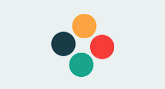
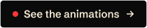
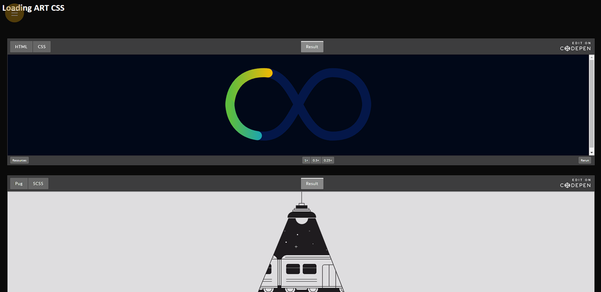

<a id="top"></a>

<div align="center">



<h1>loading</h1>

<p>
  <strong>A collection of CSS loading animations from around the web, on one static page.</strong><br />
  <sub>CodePen animations by various authors, shown as a static PWA</sub>
</p>

<p>
  <a href="https://voaneves.github.io/loading/"><picture><source media="(prefers-color-scheme: dark)" srcset="https://raw.githubusercontent.com/voaneves/loading/main/assets/buttons/live-dark.svg" /></picture></a>
  <a href="#getting-started"><picture><source media="(prefers-color-scheme: dark)" srcset="https://raw.githubusercontent.com/voaneves/loading/main/assets/buttons/start-dark.svg" /></picture></a>
</p>

<p><sub>Need something like this? <a href="https://voaneves.com/en/#contact"><strong>Let's talk →</strong></a></sub></p>

<p>
  <a href="https://github.com/voaneves/loading/blob/main/LICENSE"></a>
  
</p>

<p>
  <a href="https://voaneves.github.io/loading/">Live demo</a> ·
  <a href="#features">Features</a> ·
  <a href="#getting-started">Getting started</a> ·
  <a href="#to-do">To do</a> ·
  <a href="#contact">Contact</a>
</p>

</div>

<picture>
  <source media="(prefers-color-scheme: dark)" srcset="https://raw.githubusercontent.com/voaneves/loading/main/assets/brand/rule-dark.svg" />
  <source media="(prefers-color-scheme: light)" srcset="https://raw.githubusercontent.com/voaneves/loading/main/assets/brand/rule-light.svg" />
  
</picture>

## About the project

A single page that gathers loading animations found around the web, so you can compare them and read the code behind each one.

<p align="center">
  <a href="https://voaneves.github.io/loading/">
    
  </a>
</p>

The animations are CodePen embeds by various authors; each keeps its own credit. The page is hosted on GitHub Pages.

**Demo:** <https://voaneves.github.io/loading/>

*Em português: coleção de animações de carregamento em CSS, exibidas numa página estática (PWA).*

### Technologies

HTML, CSS and JavaScript, with no dependencies.

## Features

- A variety of loading animations.
- Well-documented code for each animation.
- Static PWA page.

## Getting started

1. Clone the repository:

   ```bash
   git clone https://github.com/voaneves/loading.git
   ```

2. Open `index.html` in a web browser.

## To do

- [ ] Add more loading animations
- [x] Optimize for mobile devices
- [x] Update the README images

## Reporting bugs

Found a bug? Check the [issues](https://github.com/voaneves/loading/issues) first; if it is not there, open a new one with a clear title, the steps to reproduce it and, if possible, screenshots. Pull requests are welcome too.

## License

This project is licensed under the MIT License.

## Contact

<p>
  <a href="https://voaneves.com/en/#contact"><picture><source media="(prefers-color-scheme: dark)" srcset="https://raw.githubusercontent.com/voaneves/loading/main/assets/buttons/hire-dark.svg" /></picture></a>
  <a href="https://voaneves.com/en/"><picture><source media="(prefers-color-scheme: dark)" srcset="https://raw.githubusercontent.com/voaneves/loading/main/assets/buttons/site-dark.svg" /></picture></a>
</p>

<a href="https://linkedin.com/in/voaneves">LinkedIn</a> · <a href="mailto:victorneves478@gmail.com">E-mail</a>

<p align="center">
  
</p>

<p align="center"><sub>Released under the <a href="https://github.com/voaneves/loading/blob/main/LICENSE">MIT License</a>.</sub></p>

<p align="center"><sub><a href="#top">↑ Back to top</a></sub></p>
